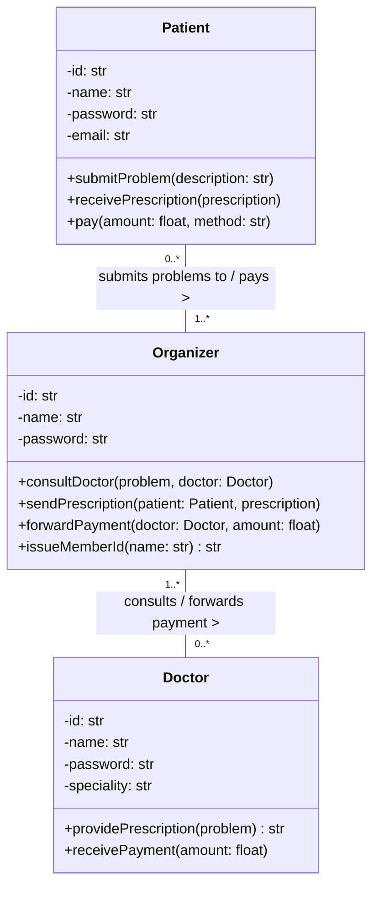
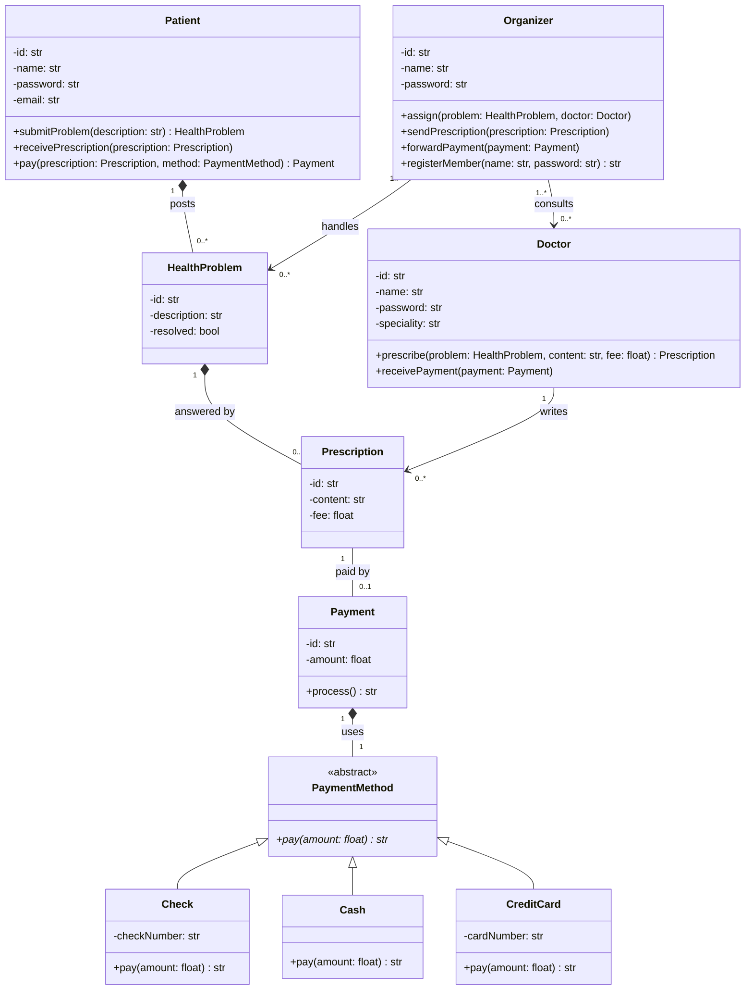
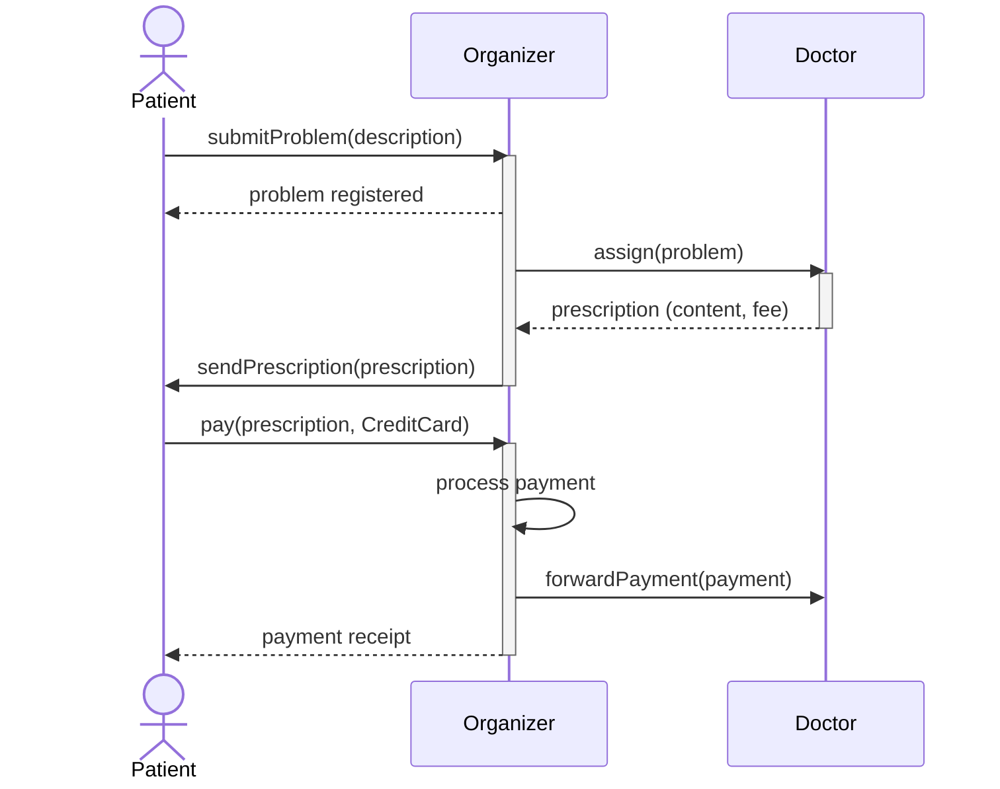
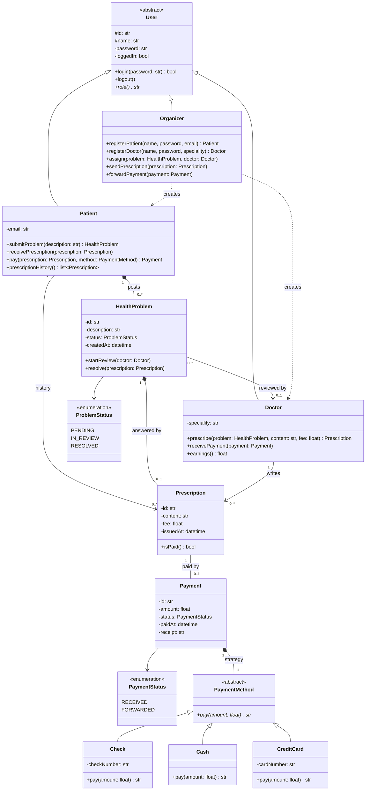
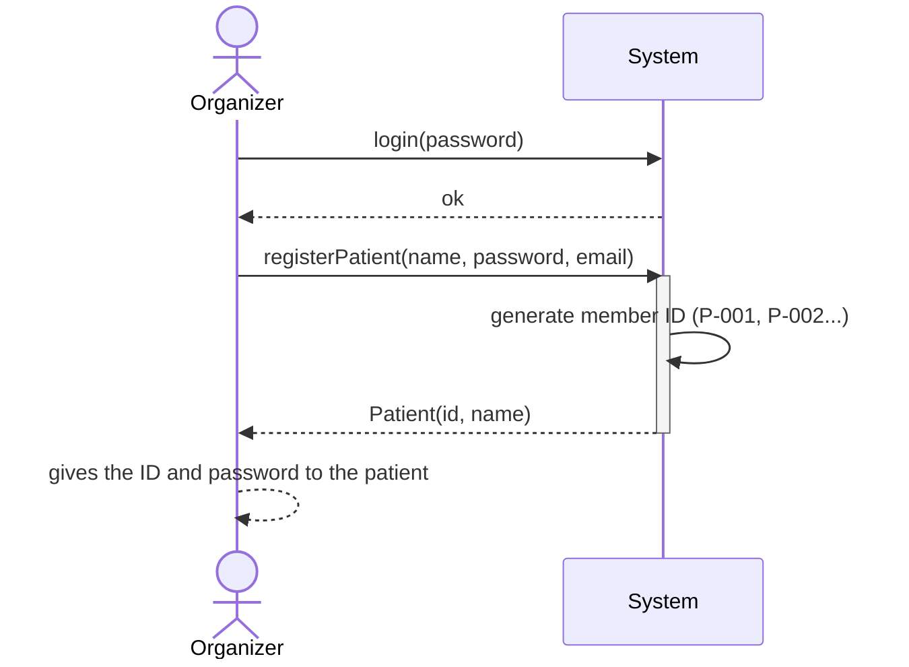
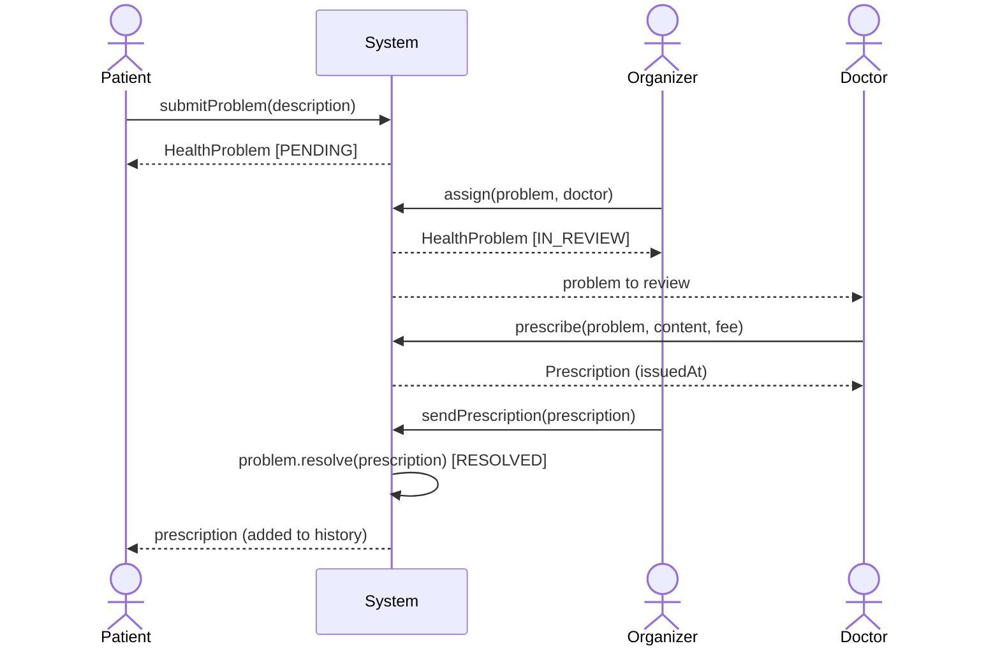
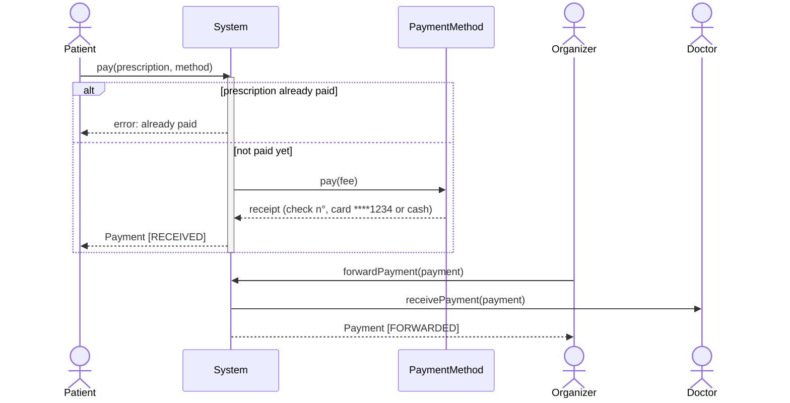

# 04 — UML practice (slide 68)

Statement: <https://gist.github.com/bdallard/2d2407c4de4c182afca6d3ec7235e9eb>

The diagrams are written in [Mermaid](https://mermaid.js.org/): GitHub renders them directly.
The Python implementation of the final designs is in [`hospital/`](hospital/) and
[`abcd_records/`](abcd_records/), with tests in [`tests/`](tests/).

**Notation reminder (slides 46, 65-66)**

| Relationship | Meaning | Mermaid |
|---|---|---|
| Association | "uses / knows" | `A --> B` |
| Dependency | weak, temporary use (parameter, local variable) | `A ..> B` |
| Aggregation | whole-part, the part can live without the whole | `A o-- B` |
| Composition | whole-part, the part dies with the whole | `A *-- B` |
| Inheritance | "is a" | `Parent <\|-- Child` |
| Realization | implements an interface / abstract class | `Interface <\|.. Impl` |

Multiplicities: `1` exactly one, `0..1` optional, `*` or `0..*` any number, `1..*` at least one.

---

# Exo 1 — Hospital Management System 🏥

## Task 1 — Basic class diagram

Three actors only. Each one has the attributes it needs to log in, and the methods that
match its steps in the business workflow.

Why these multiplicities:
- A patient talks only to organizers, never directly to a doctor (steps 1, 4, 5). There is at least
  one organizer on the platform, and an organizer handles any number of patients.
- An organizer can consult many doctors, and a doctor can be consulted by several organizers.
- There is no Patient–Doctor association: in the workflow, the organizer is always the intermediary.

## Task 2 — Complete class diagram (6 classes)

New classes: `HealthProblem`, `Prescription`, `Payment`, plus the payment types.
I model the payment types by **inheritance from an abstract `PaymentMethod`**, not with an
enumeration: each type has its own data (check number, card number) and its own way of
being processed. An enum would force an `if/elif` on the type everywhere (slide 86).

Design choices:
- **Composition** `Patient *-- HealthProblem`: a problem has no meaning without the patient who posted it.
  `HealthProblem *-- Prescription` follows the same logic: a prescription answers exactly one problem.
- **`Payment *-- PaymentMethod`**: the payment *has a* method (composition rather than inheritance,
  slide 87). We do not create `CheckPayment`, `CashPayment`... All the payment logic (amount, status,
  date) is written once in `Payment`, and only the "how to pay" part varies.
- `Doctor --> Prescription` is a simple association: the doctor writes the prescription, but the
  prescription belongs to the problem.

### Sequence diagram — a patient submits a problem, receives a prescription and pays

## Task 3 — Advanced design

Additions asked by the statement:
- an abstract **`User`** superclass for what all actors share: id, name, password, login/logout.
  This removes the triple copy of these attributes (DRY), and an organizer can manage "users" in general;
- the payment strategy modelled with **polymorphism** (`PaymentMethod.pay` is abstract);
- a **`ProblemStatus`** enumeration (PENDING → IN_REVIEW → RESOLVED). Here an enum *is* the right
  tool: a status is pure data, with no specific behaviour per value;
- **timestamps** (`createdAt`, `issuedAt`, `paidAt`) and the **history of past prescriptions**
  of each patient.

`#` = protected (subclasses may use it), `-` = private, `+` = public, `*` after a method = abstract.
`role()` is abstract: `User` cannot be instantiated, and every concrete user must say what it is.

### System sequence diagram 1 — Patient registration (organizer creates a new member)

### System sequence diagram 2 — Consultation flow (problem submission → prescription delivery)

### System sequence diagram 3 — Payment processing (patient pays, organizer forwards to doctor)

The `PaymentMethod` lifeline shows the polymorphism: the system calls the same `pay()`,
and the real object (Check, Cash or CreditCard) decides how it is done.

## Questions to consider

**1. How would you handle a patient consulting multiple doctors?**
The multiplicity is already `Patient 1 — 0..* HealthProblem`, and each problem is reviewed by
`0..1` doctor. A patient can therefore consult several doctors by posting several problems, each
assigned to a different doctor, and the full history stays available. If one *single* problem
needs several opinions, I would change `HealthProblem "0..*" --> "0..1" Doctor` into a
**`Consultation`** association class (problem, doctor, date, opinion) with multiplicity `1..*`.
That way the "who reviewed what, and when" information has a place to live.

**2. Should prescriptions be reusable? How would you model that?**
A prescription *issued* to a patient should not be reused: it is a medical and legal record,
tied to one problem, one doctor and one date. So it stays immutable, in composition with its problem.
What can be reused is its *content*: I would add a `PrescriptionTemplate` (standard treatment,
e.g. "paracetamol 1g x3/day") that the doctor picks from. Each new `Prescription` *references* a
template (association `0..* --> 0..1`, not composition), and keeps its own date, patient and fee.
A renewal can also point to the original prescription (`renewedFrom: Prescription`).

**3. What design pattern fits the payment system?**
The **Strategy** pattern (slides 82, 86): `PaymentMethod` is the strategy interface, and `Check`,
`Cash` and `CreditCard` are the concrete strategies. `Payment` holds one of them by composition.
Adding a new method (PayPal, bank transfer) means adding one class, without modifying `Payment`
(Open/Closed principle), and there is no `if method == "check"` anywhere. A **Factory** could
create the right strategy from the patient's choice in the user interface.

**4. How do you ensure data integrity when payments are processed?**
- Validate before acting: the amount must equal the prescription fee, and the prescription must
  have been delivered and not be paid already (no double payment).
- Use state transitions that can only go forward (`RECEIVED → FORWARDED`): a payment cannot
  be forwarded twice, and a problem cannot go back to `PENDING`.
- Keep the attributes private and expose them through read-only `@property` (encapsulation):
  nobody can write `payment.amount = 0` from outside.
- In a real system: a database **transaction** (the payment is saved and the prescription is marked
  as paid together, or neither), an idempotency key so that a retried request does not charge
  twice, an audit log with timestamps, and never storing a full card number (only the last 4 digits).
