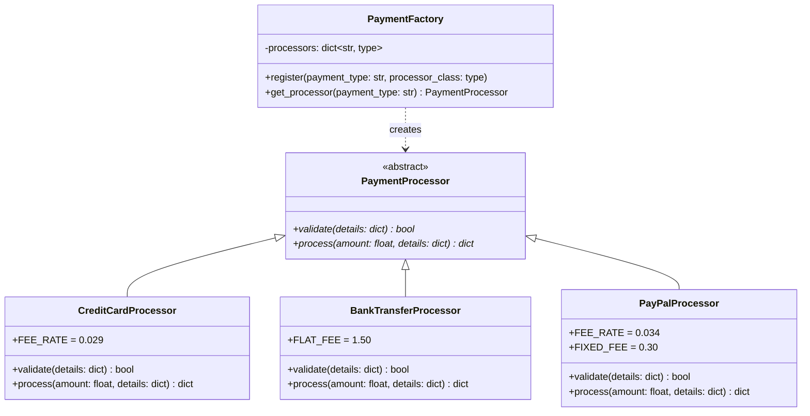

# 05 — Design patterns in practice (slide 84)

Statements (course website):
[creational](https://courses.dallard.tech/sys_design/creational_pattern/) ·
[structural](https://courses.dallard.tech/sys_design/structural_pattern/) ·
[behavioral](https://courses.dallard.tech/sys_design/behavioral_pattern/)

Each exercise gives a piece of "spaghetti" code to refactor with one pattern. The statements ask
to **draw the UML class diagram before coding** (slide 85), so each section below starts with it,
followed by the design choices.

| Family | Pattern | Package | Demo |
|---|---|---|---|
| Creational | Factory Method — payment system | [`creational/factory/`](creational/factory/) | `python -m creational.factory` |
| Creational | Builder — HR employee onboarding | [`creational/builder/`](creational/builder/) | `python -m creational.builder` |
| Creational | Singleton — configuration manager | [`creational/singleton/`](creational/singleton/) | `python -m creational.singleton` |
| Structural | Adapter — XML → JSON reports | [`structural/adapter/`](structural/adapter/) | `python -m structural.adapter` |
| Structural | Decorator — order pricing | [`structural/decorator/`](structural/decorator/) | `python -m structural.decorator` |
| Behavioral | Strategy — report formats | [`behavioral/strategy/`](behavioral/strategy/) | `python -m behavioral.strategy` |
| Behavioral | Template Method — ETL pipelines | [`behavioral/template_method/`](behavioral/template_method/) | `python -m behavioral.template_method` |

Run the demos from this folder (`cd 05_design_patterns`) with the venv activated. The tests are in
[`tests/`](tests/) and run with `pytest` from the root of the repository.

Code organisation (slide 87): **one class per file** for each pattern, and the files of a pattern are grouped in
their own package. Each `__init__.py` re-exports the public classes, so the callers write
`from creational.factory import PaymentFactory` without knowing the file layout.

---

## Creational — Factory Method: payment system

**Problem**: a single `process_payment` function with an `if/elif` on the payment type. Adding
the 20 new methods planned means opening and modifying that function every time: it violates the
**Open/Closed principle**, and a typo in one branch can break the whole checkout.

Design choices:
- **ABC** `PaymentProcessor`: every processor has the same two methods, so the caller only depends
  on the abstraction (Dependency Inversion). A processor that forgets a method cannot even be created.
- Each processor **owns its rules** (fees, validation) as named constants, in its own file.
- **The factory uses a dictionary** `name → class`, as the statement asks: one lookup replaces the `if/elif` chain.
  `register()` adds a new method **without modifying existing code**. An unknown name raises
  `ValueError`, so the error cannot be silently ignored.
- Each factory instance copies the default registry, so registering a method on one factory (in a test,
  for example) does not leak into the others.
