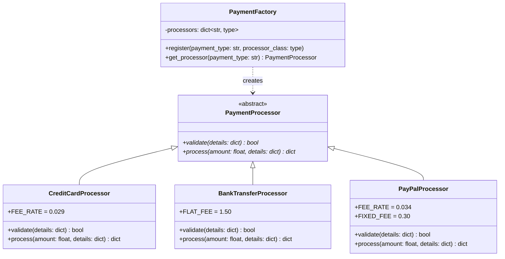
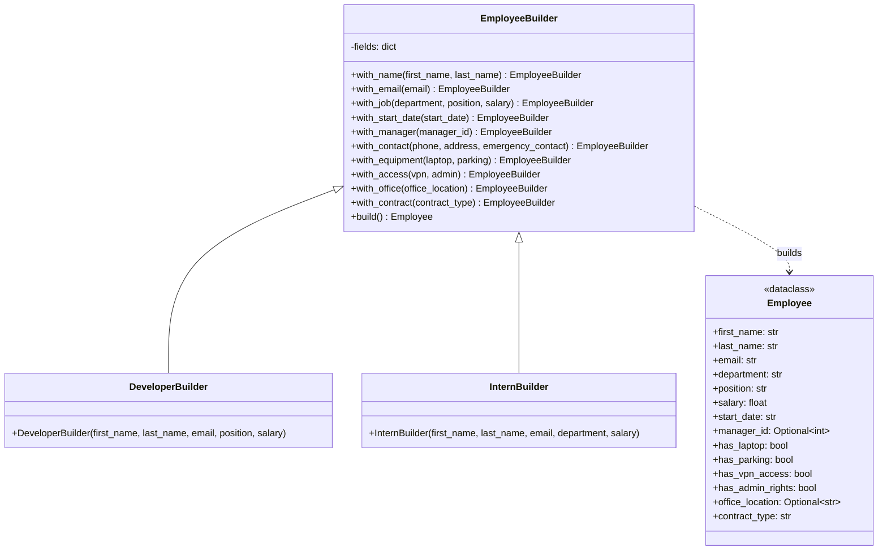
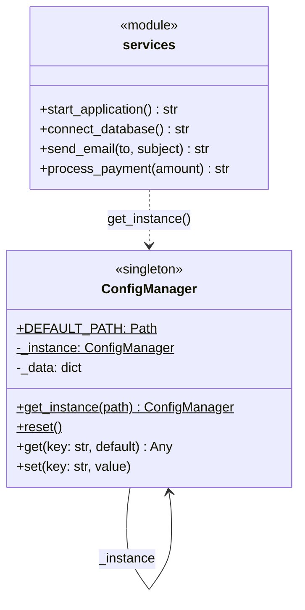
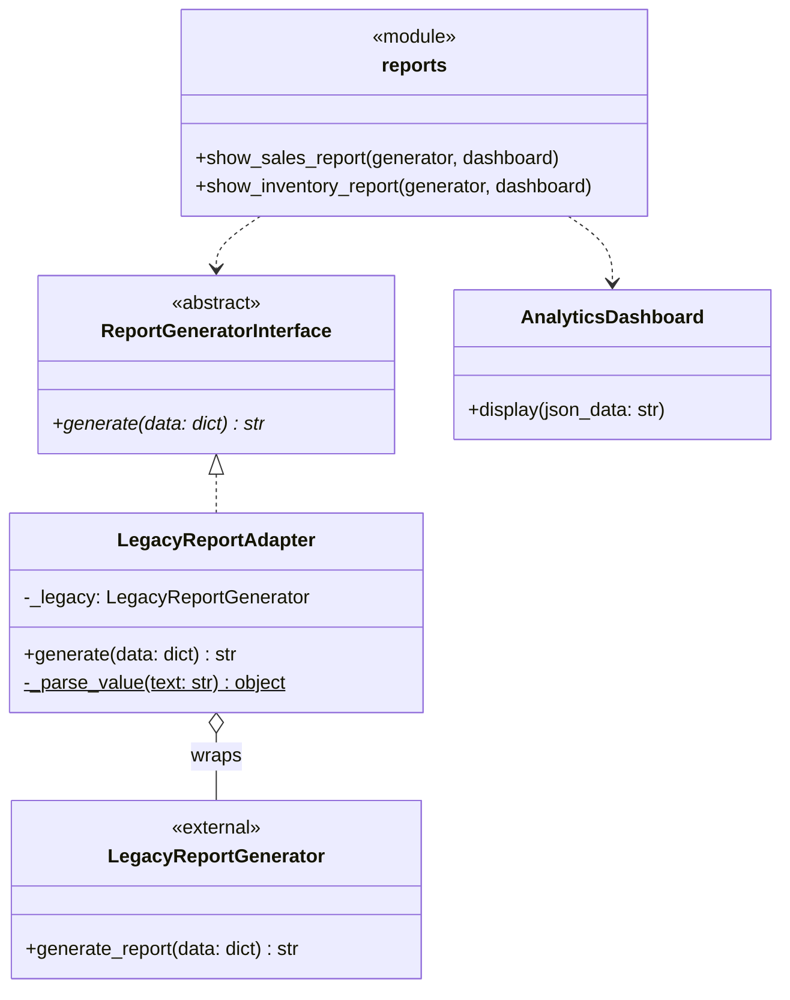
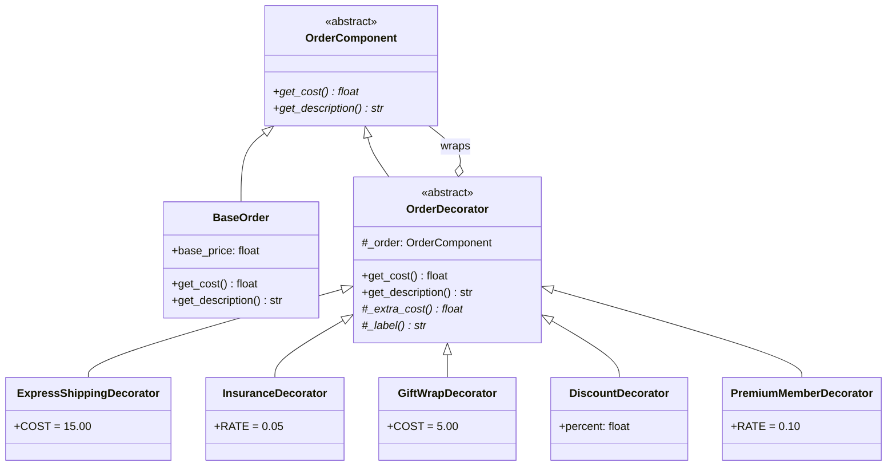

# 05 — Design patterns in practice (slide 84)

Statements (course website):
[creational](https://courses.dallard.tech/sys_design/creational_pattern/) ·
[structural](https://courses.dallard.tech/sys_design/structural_pattern/) ·
[behavioral](https://courses.dallard.tech/sys_design/behavioral_pattern/)

Each exercise gives a piece of "spaghetti" code to refactor with one pattern. The statements ask
to **draw the UML class diagram before coding** (slide 85), so each section below starts with it,
followed by the design choices.

| Family | Pattern | Package | Demo |
|---|---|---|---|
| Creational | Factory Method — payment system | [`creational/factory/`](creational/factory/) | `python -m creational.factory` |
| Creational | Builder — HR employee onboarding | [`creational/builder/`](creational/builder/) | `python -m creational.builder` |
| Creational | Singleton — configuration manager | [`creational/singleton/`](creational/singleton/) | `python -m creational.singleton` |
| Structural | Adapter — XML → JSON reports | [`structural/adapter/`](structural/adapter/) | `python -m structural.adapter` |
| Structural | Decorator — order pricing | [`structural/decorator/`](structural/decorator/) | `python -m structural.decorator` |
| Behavioral | Strategy — report formats | [`behavioral/strategy/`](behavioral/strategy/) | `python -m behavioral.strategy` |
| Behavioral | Template Method — ETL pipelines | [`behavioral/template_method/`](behavioral/template_method/) | `python -m behavioral.template_method` |

Run the demos from this folder (`cd 05_design_patterns`) with the venv activated. The tests are in
[`tests/`](tests/) and run with `pytest` from the root of the repository.

Code organisation (slide 87): **one class per file** for each pattern, and the files of a pattern are grouped in
their own package. Each `__init__.py` re-exports the public classes, so the callers write
`from creational.factory import PaymentFactory` without knowing the file layout.

---

## Creational — Factory Method: payment system

**Problem**: a single `process_payment` function with an `if/elif` on the payment type. Adding
the 20 new methods planned means opening and modifying that function every time: it violates the
**Open/Closed principle**, and a typo in one branch can break the whole checkout.

Design choices:
- **ABC** `PaymentProcessor`: every processor has the same two methods, so the caller only depends
  on the abstraction (Dependency Inversion). A processor that forgets a method cannot even be created.
- Each processor **owns its rules** (fees, validation) as named constants, in its own file.
- **The factory uses a dictionary** `name → class`, as the statement asks: one lookup replaces the `if/elif` chain.
  `register()` adds a new method **without modifying existing code**. An unknown name raises
  `ValueError`, so the error cannot be silently ignored.
- Each factory instance copies the default registry, so registering a method on one factory (in a test,
  for example) does not leak into the others.

---

## Creational — Builder: HR employee onboarding

**Problem**: `create_employee` takes 17 parameters, the "telescoping constructor" smell. A single missing
`None` shifts every following argument, a call like `False, True, True, True` is unreadable, and nothing
guarantees business rules such as "a senior developer always gets admin rights".

Design choices:
- **Product** = a `@dataclass(frozen=True)`: a plain data container, immutable once built, so
  nobody can bypass the validation by modifying it afterwards.
- **Fluent builder**: each `with_...` method returns `self`, which allows chaining. Related values are
  grouped (name, job, equipment, access), and booleans are passed **by keyword** (`laptop=True`).
- **Validation in `build()` only**: one place, run once, just before the product exists.
- **Presets** `DeveloperBuilder` and `InternBuilder` are pre-filled builders, with the values of the two
  examples of the statement. The business rules live there (senior → admin rights, intern →
  internship contract without VPN). The result is still a builder, so it can be adjusted before `build()`.

---

## Creational — Singleton: configuration manager

**Problems identified** (from the statement): the file is read on every call (wasteful I/O), each module
loads its own copy (no shared state), so a change made by one module is not seen by the others,
and there is no single point to override in tests.

(`$` = static/class member in Mermaid.)

Design choices:
- The single instance is stored in a **class attribute** `_instance`, and `get_instance()` is a
  **`@classmethod`** (slide 87) that creates it on the first call only. The file is read once.
- `__init__` **refuses a second instance** (`RuntimeError`): without this guard, `ConfigManager()`
  could silently create a second copy of the config, which is the problem the pattern solves.
- `get("database.host")` walks the nested dictionaries. A missing key returns a default value
  instead of crashing on a `KeyError`.
- `set()` changes the shared state, so every module sees the change (problem 3).
- `reset()` is the single point for tests (problem 4). The tests reset the singleton around each
  test and load a temporary config file.
- The services **return** their message instead of printing it, so they are testable. The demo prints them.
- Alternative mentioned on slide 87: a **module-level instance** (`config = ConfigManager(...)`
  in a module) is also a singleton in Python, because a module is imported only once.

---

## Structural — Adapter: legacy XML reports for a JSON dashboard

**Problems identified** (from the statement): incompatible interfaces (the legacy generator returns XML, the
dashboard expects JSON), conversion logic repeated in every report function, a legacy system
we cannot modify (external library), and business logic mixed with format conversion.

Design choices:
- **Object adapter (composition)**: `LegacyReportAdapter` *implements* the interface expected by the new
  code, and *wraps* a `LegacyReportGenerator` that it receives in its constructor. The legacy class is not
  modified and not inherited, so its XML API never leaks out of the adapter.
- The adapter **really converts the XML output** (`xml.etree.ElementTree`), unlike the old code that
  "cheated" by dumping the original data again. XML only stores text, so `_parse_value` turns numbers
  back into `int`/`float`.
- The XML → JSON conversion is written **once**. The report functions depend only on
  `ReportGeneratorInterface` (Dependency Inversion): a native JSON generator could replace the adapter later.

---

## Structural — Decorator: order pricing

**Problems identified** (from the statement): boolean flags multiply (5 flags, and more means more parameters),
one method does everything (it violates Single Responsibility), a new option means modifying existing code,
options cannot be reused, and the order of operations is unclear.

Design choices:
- A decorator **is** an `OrderComponent` (inheritance) and **has** an `OrderComponent` (composition,
  `_order`). So decorators wrap each other in any order and any number, and the caller always sees the same interface.
- The wrapped object is stored in a **protected `_order`** (slide 87). `OrderDecorator` writes the
  delegation once (`wrapped cost + extra`, `wrapped description + line`), and each concrete decorator only
  says what it adds (`_extra_cost`, `_label`), with its rate as a named constant.
- **One class per file** in [`decorators/`](structural/decorator/decorators/), like the
  `orders/decorators/` example of slide 87. A new option is a new file, and nothing else changes (Open/Closed).
- **The order of operations is now explicit**: each decorator applies to what it wraps. Note that the
  old code computed the insurance on the *base price* only (5.00€). Here, with the order of the
  statement (express then insurance), the insurance covers the goods plus shipping, which gives
  5.75€ and a total of 96.20€. To insure the goods only, wrap `BaseOrder` with `InsuranceDecorator` first
  (see `test_order_of_decorators_matters`).
